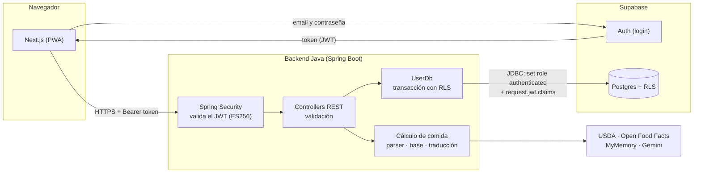
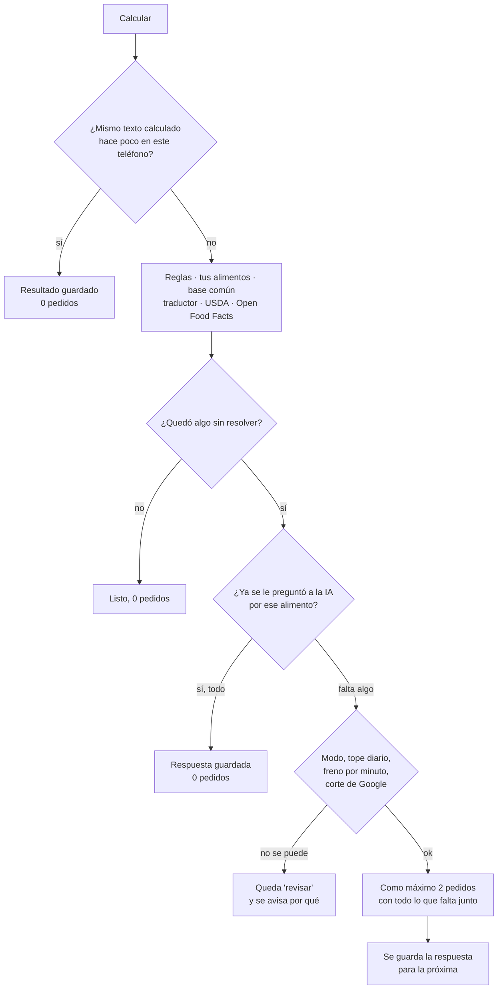

# Nutrify

Tracker de comida, agua, pasos, peso y gym. Escribís lo que comiste en texto libre ("200 g de pollo y media palta") y la app devuelve kcal, proteína, carbos y grasas.

**Frontend:** Next.js 15 + React 19 + TypeScript + Tailwind (PWA, mobile first)
**Backend:** Java 21 + Spring Boot 4 + JDBC + Spring Security (JWT)
**Base y login:** Supabase (Postgres 17 con Row Level Security + Auth)

## Arquitectura



- El navegador usa Supabase **solo para iniciar sesión**. Todos los datos y el cálculo pasan por el backend.
- El backend valida el token y consulta Postgres **como ese usuario**: cada transacción arranca con `set_config('request.jwt.claims', …)` y `role = authenticated`, igual que PostgREST. Las políticas RLS de la base filtran solas, así que un error en una consulta no puede mostrar datos de otro usuario.
- Las claves de USDA y Gemini viven solo en el backend.

## APIs que usa

| API | Para qué | Costo y cuidado |
|---|---|---|
| **Supabase Auth** | Login con email y contraseña. Emite el JWT que valida el backend | El backend solo lee las claves públicas (JWKS) |
| **USDA FoodData Central** | Valores por 100 g de alimentos genéricos (pollo, arroz, banana) | Gratis con clave. Respuestas guardadas 7 días |
| **Open Food Facts** | Productos envasados (marcas) | Gratis, sin clave. Respuestas guardadas 7 días |
| **MyMemory** | Traducir al inglés el nombre del alimento para buscarlo en USDA, cuando el diccionario propio no alcanza | Gratis, sin clave. Respuestas guardadas 30 días |
| **Google Gemini** (Flash-Lite) | Último recurso: entender textos difíciles, estimar valores o el peso de 1 unidad | Plan gratis. Ver abajo cómo se gasta lo menos posible |

Las búsquedas a USDA, Open Food Facts y MyMemory van en paralelo con hilos virtuales, con tiempo máximo por pedido (5 a 8 s) y una memoria en el servidor para no repetir la misma consulta.

## Cómo se calcula una comida

Cada línea pasa por estos pasos y se queda en el primero que la resuelve:

1. **Parser por reglas:** separa por línea, `+`, `;`, coma o " y ". Entiende `g`, `ml`, `kg`, `scoop`, `cucharada`, `taza`, `feta`, cantidades en palabras ("dos huevos", "media palta"), fracciones y cantidad al final ("pollo 200g"). "Tarta de jamón y queso" no se corta en el "y" si es un alimento conocido.
2. **Tus alimentos guardados**, con alias, plurales y tolerancia a errores de tipeo (Damerau-Levenshtein acotada) → origen `guardado`.
3. **Base de alimentos comunes** (88 alimentos de Argentina con valores de USDA y el peso de 1 unidad, 1 cucharada o 1 taza) → `base`.
4. **USDA y Open Food Facts:** el nombre se traduce al inglés (diccionario propio de 222 palabras y 39 frases; si no alcanza, MyMemory) y se elige el resultado que mejor coincide, no el primero → `base`.
5. **Gemini**, solo para lo que quedó sin resolver. Lo que estima la IA siempre queda marcado `revisar`.

## Cómo se gasta lo menos posible de IA

Gemini es el único servicio con un límite que importa (en el plan gratis, 15 pedidos por minuto y una cuota diaria por clave). Antes de mandarle un pedido, el backend verifica todo esto, en orden:



**Antes de llegar a la IA**
- **Memoria en el teléfono:** el mismo texto (o "Repetir" una comida) no vuelve a llamar al servidor durante 7 días. Se guardan los últimos 60 resultados y se borran si cambiás tus alimentos.
- **Todo lo que no cuesta va primero:** reglas, tus alimentos, la base común, el diccionario, USDA y Open Food Facts. Un texto común se resuelve con 0 pedidos.
- **El traductor no usa IA:** la búsqueda en inglés para USDA sale del diccionario o de MyMemory. La IA solo traduce lo que ninguno de los dos pudo.
- **Memoria de la IA en la base:** cada respuesta se guarda por usuario en `ai_cache` (con RLS), con cuatro tipos de clave: interpretación de un texto, búsqueda en inglés, peso de 1 unidad y valores por 100 g. Un alimento que ya se preguntó no se vuelve a preguntar, ni siquiera si aparece en otro texto.

**Las verificaciones antes de cada pedido**
- **Modo elegido en Perfil:** `auto` (la usa sola), `preguntarme` (por defecto) o `nunca`.
- **En modo preguntarme, se pide permiso con datos:** antes de confirmar, la app muestra qué alimentos va a completar, cuántos pedidos va a usar (1 o 2), cuántos te quedan hoy y el estado de Google. El botón se habilita solo si va a poder.
- **Estado sin gastar:** `GET /api/ai-status` consulta los datos del modelo en Google, que no genera nada ni gasta cuota. El resultado se guarda 5 minutos.
- **Tope diario por usuario:** 40 pedidos, contados en la base (sobrevive a reinicios y a varias instancias del servidor).
- **Freno por minuto:** como máximo 10 pedidos por minuto, por debajo de los 15 del plan gratis.
- **Si Google ya cortó, no se insiste:** si respondió "límite por minuto", "cuota diaria agotada" o "clave rechazada", no se manda nada hasta que se libere (la cuota diaria, hasta la medianoche del Pacífico, cuando Google la renueva). Ese estado también se guarda en la base.
- **Apagado general:** `AI_DISABLED=1` la apaga para todos sin tocar código.
- **Límites de entrada:** hasta 2000 caracteres y 30 alimentos por cálculo.

**Cuando sí se usa**
- **Como máximo 2 pedidos por cálculo**, sin importar cuántos alimentos tenga el texto: uno para entender y traducir, otro para estimar valores y pesos por unidad. Cada uno lleva **solo lo que falta**, todo junto.
- **Respuesta en JSON con esquema estricto**, devuelta por índice para no mezclar alimentos.
- **Sin reintentos que gasten:** un error de límite no se reintenta. El único reintento es si el modelo configurado no existe: se prueba con el alias `gemini-flash-lite-latest`.
- **Nunca se toma como dato seguro:** lo que estima la IA queda marcado `revisar`, con la sugerencia de guardarlo en tus alimentos para la próxima.

## Seguridad

- El token se valida con las claves públicas del proyecto: firma, vencimiento, emisor y audiencia.
- Los datos pasan por RLS en cada consulta, sin depender de que el código filtre bien.
- Una fila de otro usuario responde 404, igual que una que no existe.
- La clave foránea `workouts.routine_id` no respeta RLS, así que el backend verifica que la rutina sea tuya antes de enganchar un entreno.
- [`cerrar-acceso-directo.sql`](backend/sql/cerrar-acceso-directo.sql) le saca al navegador el acceso directo a las tablas, con una consulta de verificación ✅/❌.

## Transacciones

- Guardar varias líneas de comida es una sola transacción: se guardan todas o ninguna.
- Corregir una línea (borrar la vieja y guardar las nuevas) también.
- Renombrar un ejercicio en todo el historial de entrenos y rutinas también.
- Los totales por día y la actividad semanal se calculan en SQL, en vez de traer todas las filas al teléfono.

## Tests

Los tests no necesitan Supabase, Docker ni internet.

| Suite | Qué prueba |
|---|---|
| `GoldenTest` | Casos de referencia: 76 textos y 6 casos con IA con salida esperada, más el parser, los gramos, la base, el traductor y la distancia de edición |
| `ApiTest` | Tokens válidos, vencidos, de otro proyecto y anónimos; errores; CORS; estado de la IA |
| `DataApiTest` | Los ~40 endpoints de datos contra Postgres real con RLS, con dos usuarios |
| `LockdownTest` | Acceso directo cerrado: anon bloqueado, backend andando, SQL que se puede correr dos veces |

- **Casos de referencia:** [`golden.json`](backend/src/test/resources/golden/golden.json) tiene entradas y la salida esperada de cada una, con USDA, Open Food Facts, el traductor y Gemini simulados. [`GoldenTest`](backend/src/test/java/app/nutrify/nutrition/GoldenTest.java) compara las líneas calculadas, los prompts que se mandan a Gemini, lo que se guarda en la memoria de la IA y los pedidos de red. También prueba los cortes de Google: que después de un "límite" no se mande nada más.
- **Postgres real, sin Docker:** [`DataApiTest`](backend/src/test/java/app/nutrify/web/DataApiTest.java) levanta un Postgres 17 embebido y carga [`supabase/schema.sql`](supabase/schema.sql) tal cual, más lo mínimo de Supabase (`auth.uid()`, roles). Cada test crea dos usuarios y prueba que uno no puede ver, cambiar ni borrar lo del otro, incluso con un `update` sin `where` directo en la base. Si se saca el cambio de rol de `UserDb`, fallan 6 de los 7.

GitHub Actions ([`ci.yml`](.github/workflows/ci.yml)) corre los tests del backend y el typecheck y build del frontend en cada push.

## Estructura

```
frontend/   Next.js: pantallas, componentes y lib/api.ts (cliente del backend)
backend/    Spring Boot
  nutrition/  cálculo de comida: parser, base, traductor, USDA, Gemini
  data/       repositorios JDBC por área (perfil, comidas, actividad, gym)
  web/        controllers REST, errores y validación
  db/         UserDb: transacciones con RLS
  sql/        cerrar el acceso directo a las tablas
supabase/   schema.sql: tablas, índices y políticas RLS
```

## Correrlo localmente

Hace falta un proyecto de Supabase con [`supabase/schema.sql`](supabase/schema.sql) cargado.

```bash
# Backend: completá backend/.env a partir de backend/.env.example
cd backend
./mvnw spring-boot:run

# Frontend: completá frontend/.env.local a partir de frontend/.env.example
cd frontend
npm install
npm run dev
```

Tests:

```bash
cd backend
./mvnw test
```

Más detalle del backend (endpoints, variables, cómo funciona la seguridad) en [`backend/README.md`](backend/README.md).
